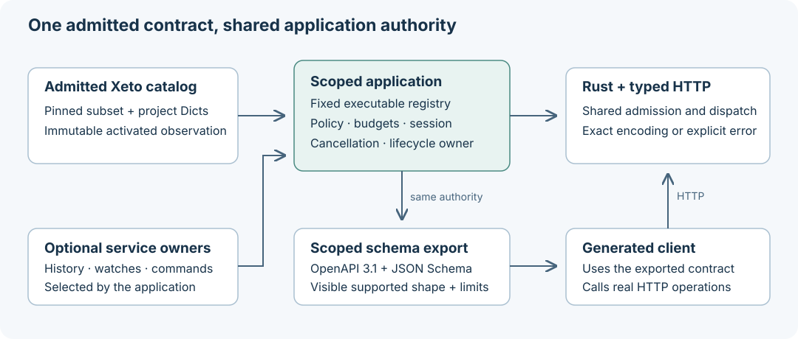

# Rusty Haystack

Rust libraries and tools for modeling building data with [Project Haystack](https://project-haystack.org): typed values, entity graphs, filters, codecs, an HTTP server and client, and Python bindings.

[](LICENSE)

This README describes the **`dev` branch**. It includes the in-progress, bounded Xeto and typed HTTP work in the 0.9.0 source tree; those capabilities should not be assumed to exist in published releases. The existing Haystack 4 interfaces remain available for compatibility.

## What you can build

- **Model and query building data.** Use Dicts, Grids, references, units, Haystack filters, indexed entity graphs, relationship traversal, and the bundled Haystack ontology.
- **Exchange data.** Read and write Zinc, Haystack JSON, Trio and CSV. The separate contextual Jeto codec supports selected typed values and reports when an encoding would lose information.
- **Embed an application with explicit limits.** Share authorization, catalog observations, request budgets, cancellation, and lifecycle ownership across Rust and scoped HTTP consumers. The pure `EntityGraph` is a trusted in-process API; it does not apply application policy by itself.
- **Select the services you need.** Entity mutations, history reads and writes, state subscriptions, and local point-write simulation are explicit application capabilities. Selecting a schema declaration alone never installs a handler or enables a provider.
- **Use an admitted typed contract.** A pinned subset of Xeto supplies executable function signatures, defaults, metadata and codec contexts. Trusted catalog activation validates affected data before publishing a new immutable observation. Project additions currently admit a bounded Dict closure.
- **Generate a client from the selected API.** A scoped application can export OpenAPI 3.1 and a standalone JSON Schema 2020-12 definition library. The repository validates an unedited generated Python client over real loopback HTTP, including defaults, errors and exact unboxing limits.



The typed work is a selected implementation, not complete Haystack 5 or upstream runtime interoperability. JSON Schema validates JSON shape; it cannot prove nominal identity, resolve graph references, preserve an ambiguous union branch, or guarantee that every native value can be encoded exactly without boxes. Point-write behavior is a **local simulator**, with no physical equipment command authority. The included ephemeral mutation/history implementations do not establish durable storage or restart recovery.

## Start from source

Install the repository-pinned Rust **1.99.0** toolchain, then:

```sh
git clone --branch dev https://github.com/jscott3201/rusty-haystack.git
cd rusty-haystack
cargo build --locked --workspace --exclude rusty-haystack
cargo test --locked --workspace --exclude rusty-haystack
cargo run --locked -p rusty-haystack-cli -- serve --demo --port 8080
```

The exclusion is the PyO3 extension package, which is built through Maturin with a Python interpreter. See [Contributing](CONTRIBUTING.md) for its separate build and tests.

The demo listens on `127.0.0.1:8080` and uses the compatibility server profile. In another terminal:

```sh
curl http://127.0.0.1:8080/api/about
curl -X POST http://127.0.0.1:8080/api/read \
  -H 'Content-Type: text/zinc' \
  -d 'ver:"3.0"
filter
"site"'
```

To embed the scoped application and select typed capabilities, follow [Shared application reads](docs/shared-reads.md), [Application lifecycle](docs/application-lifecycle.md), and the [typed HTTP contract](docs/typed-http-read.md). The CLI demo does not automatically select that application profile.

Timezone rule data is optional in the core:

```sh
cargo build --locked -p rusty-haystack-core --features chrono-tz
```

For a local container demo, build from this checkout and bind inside the container while publishing only on the host loopback interface:

```sh
docker build -t rusty-haystack .
docker run --rm -p 127.0.0.1:8080:8080 rusty-haystack \
  serve --demo --host 0.0.0.0 --port 8080
```

## Typed API and schema export

A managed scoped server exposes the project-owned endpoint below. It uses the caller's policy and selected services, with the same original request admission as typed operations:

```sh
curl -H 'Xeto-Version: 5' -H 'Accept: application/json' \
  http://127.0.0.1:8080/api/rusty-haystack/openapi.json
```

Use this against your scoped server, and supply its authentication header when enabled. The exported operation profile is **qualified POST, Xeto-Version 5, `application/json;box=none` output**. Omitted/defaulted parameters and explicit JSON null normalization are documented separately from canonical Dict fields, whose optional members are omitted. Unsupported visible declarations appear in explicit exclusions; hidden declarations are not disclosed.

The document includes `x-rusty-haystack-json-schema`, a standalone Draft 2020-12 library with local `$defs`. See [Schema export and generated clients](docs/schema-export.md) for extraction, limits and the reproducible independent validation command. The endpoint is a Rusty Haystack extension, not an upstream `sys.api::openapi` operation.

## Workspace

| Crate | Role |
|---|---|
| [haystack-core](haystack-core/) | Values, codecs, filters, units, graph, ontology, Xeto admission and fitting |
| [haystack-app](haystack-app/) | Scoped reads, selected mutations/history/subscriptions/commands, catalog activation, lifecycle and resource ownership |
| [haystack-server](haystack-server/) | Axum HTTP adapters, SCRAM authentication and WebSocket transport |
| [haystack-client](haystack-client/) | Async HTTP/WebSocket client, SCRAM and TLS configuration |
| [haystack-cli](haystack-cli/) | The `haystack` command: data tools, server, client and user management |
| [rusty-haystack](rusty-haystack/) | `rusty_haystack` Python extension with selected core, graph, codec, client and server APIs |

Python coverage is described in [Python bindings](docs/python.md) and tested separately from the generated HTTP client. It is not a claim of full parity with every Rust application service.

## Documentation and validation

- [Xeto repository downloads](docs/repository-client.md)
- [Architecture](docs/architecture.md), [Getting started](docs/getting-started.md), [CLI](docs/cli.md), [Client](docs/client.md), and [Server API](docs/server-api.md)
- [Typed values](docs/typed-values.md), [Jeto](docs/jeto.md), [Typed HTTP](docs/typed-http-read.md), and [Schema export](docs/schema-export.md)
- [Entity mutations](docs/entity-mutations.md), [History reads](docs/history-reads.md), [History mutations](docs/history-mutations.md), and [State subscriptions](docs/state-subscriptions.md)
- [Configuration](docs/configuration.md), [Contributing](CONTRIBUTING.md), and the [support and validation matrix](docs/support-matrix.md)
- [Roadmap and progress](https://github.com/users/jscott3201/projects/3), and [Issues](https://github.com/jscott3201/rusty-haystack/issues)

The local full gate rebuilds and tests the Rust/Python surfaces and runs the independent schema/client proof. Hosted checks and release-artifact qualification have separate coverage; a local pass is not evidence for another platform or a published binary. First-party Rust forbids unsafe code, while dependency internals have their own policies. Authentication, authorization and limits still require deliberate application and deployment configuration.

The correctness-checked performance baseline separates cold, parsed-filter-warm and result-cache-warm graph reads, mutation followed by query, direct history reads, and loopback HTTP history reads. [Benchmarks.md](Benchmarks.md) records workloads, commands and measurement provenance. March 2026 results describe v0.8.0 on Rust 1.93.1 and do not establish current latency, capacity or a speedup.

## License

[MIT](LICENSE). Retained upstream Xeto source keeps its source license and provenance alongside the pinned profile.
